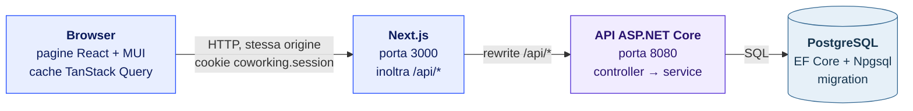
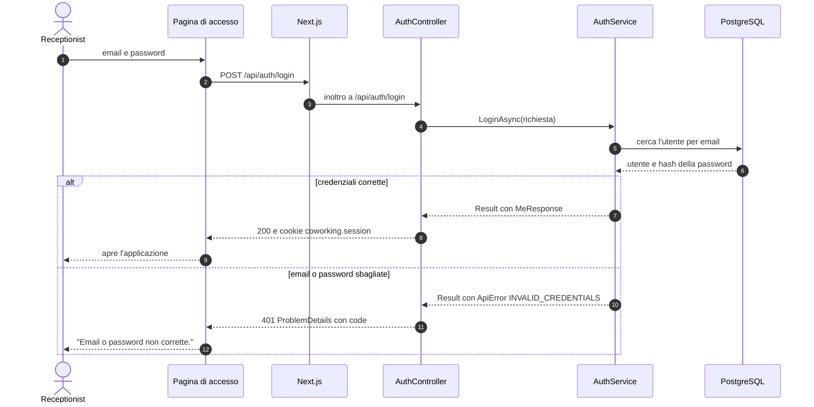
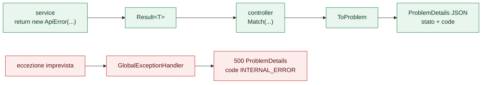
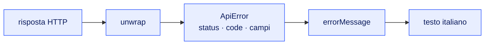
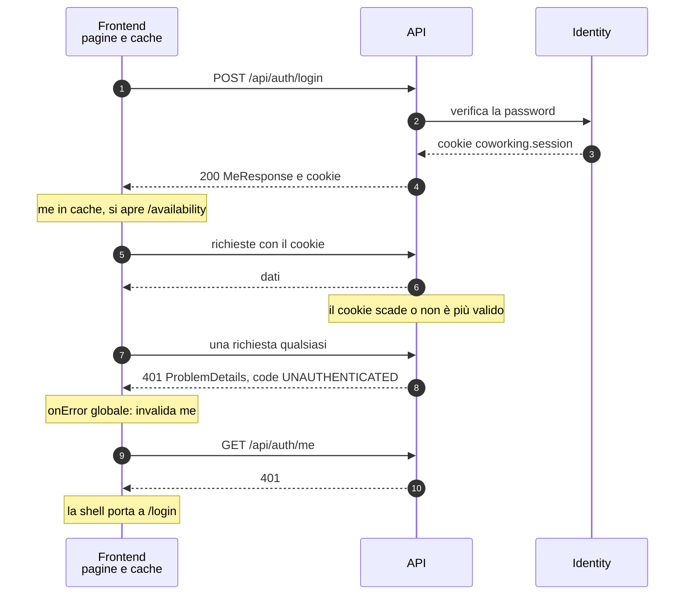
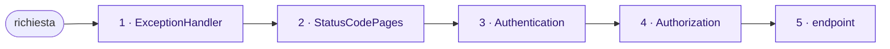
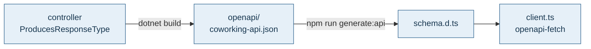
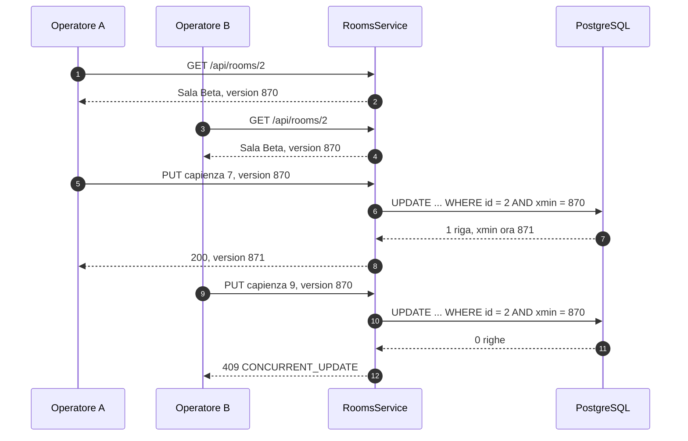

<div align="center">

# Coworking

**Prenotazione delle sale riunioni, pensata per la receptionist.**<br>
Clienti, sale e prenotazioni in un solo posto, senza sovrapposizioni.

<br>


[Avvio rapido](#avvio-rapido) ·
[Come è fatto](#come-è-fatto) ·
[Gli otto nuclei](#gli-otto-nuclei) ·
[Dove sta cosa](#dove-sta-cosa) ·
[Studiare il progetto](#studiare-il-progetto) ·
[Scelte note](#scelte-e-limiti-noti) ·
[Sviluppo](#sviluppo-locale) ·
[Problemi comuni](#problemi-comuni)

</div>

---

## In breve

| | |
|---|---|
| **Per chi** | Una receptionist, unica utente dell'applicazione. L'accesso è con email e password. |
| **Backend** | ASP.NET Core (.NET 10), controller, EF Core 10 su PostgreSQL, ASP.NET Core Identity con cookie di sessione. |
| **Frontend** | Next.js 16 (App Router), React 19, MUI 9, TanStack Query 5, TypeScript strict. |
| **Contratto** | OpenAPI generato dal backend; il frontend ne ricava i tipi, quindi un cambio all'API che rompe il client viene segnalato dal controllo dei tipi. |
| **Test** | Integrazione del backend su un PostgreSQL vero (xunit); funzioni pure del frontend (Vitest). |
| **Avvio** | `docker compose up --build`: database, API e interfaccia insieme. |

### Stato

| Parte | Stato |
|---|---|
| Accesso della receptionist, gestione errori, struttura dell'interfaccia, tema chiaro e scuro | pronto |
| Sale e clienti: elenco, modifica, disattivazione delle sale, modifiche concorrenti | pronto |
| Prenotazioni e disponibilità | in arrivo |

---

## Requisiti

| Per | Serve |
|---|---|
| Avviare tutto (avvio rapido) | Docker Desktop, oppure Docker Engine con il plugin Compose |
| Sviluppo locale e lettura del codice nell'editor | .NET SDK 10 (versione in `global.json`), Node.js 22 (`.nvmrc`) |

## Avvio rapido

Dalla cartella del progetto:

```bash
cp .env.example .env        # su Windows (PowerShell): Copy-Item .env.example .env
docker compose up --build
```

La prima build scarica le immagini di base e può richiedere qualche minuto.

| Servizio | Indirizzo |
|---|---|
| Applicazione | http://localhost:3000 |
| API (documentazione interattiva Scalar) | http://localhost:8080/scalar |
| Stato dell'API e del database | http://localhost:8080/health |
| PostgreSQL | `127.0.0.1:5433`, database e utente `coworking`, password in `.env` |

La password di `.env.example` è una password di test per il database locale, non una
credenziale reale. `.env` è ignorato da git.

**Per approfondire**

- **Docker · esercitazione, EN:** [Docker Compose Quickstart](https://docs.docker.com/compose/gettingstarted/) — collega servizi, porte e volumi al nostro `docker-compose.yml`.
- **Fireship · YouTube, EN:** [Docker in 100 Seconds](https://www.youtube.com/watch?v=Gjnup-PuquQ) — chiarisci immagine e container prima della prima build.

### Accesso

L'applicazione è riservata alla receptionist. Il suo utente (`receptionist@coworking.local`) viene
creato all'avvio con la password di `RECEPTIONIST_PASSWORD` in `.env`; cambiare la password in `.env`
e riavviare l'API la aggiorna. La password deve avere almeno 6 caratteri, con maiuscola, minuscola,
cifra e un carattere non alfanumerico (regole predefinite di ASP.NET Core Identity).
La sessione è un cookie HttpOnly di 8 ore, rinnovato a ogni uso. Non c'è blocco dopo tentativi
falliti: è un limite noto.

---

## Come è fatto

Il browser parla solo con Next.js, sulla propria origine: Next.js inoltra `/api/*` al backend, che è
l'unico a parlare con PostgreSQL. Per questo non servono richieste tra origini diverse.



**Per approfondire**

- **Next.js · guida, EN:** [Server e Client Components](https://nextjs.org/docs/app/getting-started/server-and-client-components) — distingui il codice del server dall'interattività nel browser; ritrovalo nei layout e nei file con `"use client"`.
- **Fireship · YouTube, EN:** [Next.js in 100 Seconds + tutorial](https://www.youtube.com/watch?v=Sklc_fQBmcs) — introduzione al framework; il tutorial usa il vecchio Pages Router, mentre qui si usa App Router: per gli esempi segui la guida ufficiale sopra.

### Il cammino di una richiesta

L'accesso è il percorso più completo: attraversa tutti i livelli, sia nel caso riuscito sia in quello
d'errore.



Il testo mostrato all'utente nasce dal `code` del ProblemDetails, non dal messaggio inglese del server:
è il nucleo 2 qui sotto.

---

## Studiare il progetto

Un capitolo alla volta: **schema → regola → codice → quiz → approfondimento**.

1. **Orientati:** segui [il cammino di una richiesta](#il-cammino-di-una-richiesta), dal browser al database.
2. **Capisci il comportamento:** leggi [errori](#1-flusso-degli-errori), [accesso](#3-accesso-e-sessione) e [pipeline](#4-pipeline-http), poi apri i file citati.
3. **Collega i livelli:** passa al [contratto API](#5-contratto-dellapi), allo [stile](#6-stile) e agli [stati dell'interfaccia](#7-struttura-e-stati-dellinterfaccia).
4. **Segui una feature con i dati:** [sale e clienti](#8-sale-e-clienti-dati-condivisi) mostrano unicità, modifiche concorrenti e moduli.
5. **Mettiti alla prova:** spiega un caso concreto senza guardare il codice; usa il quiz locale se disponibile, poi approfondisci il punto che ti manca.

- **Risorse vicino al concetto:** ogni capitolo offre letture o video con un obiettivo concreto. Parti dalla prima risorsa, apri le altre quando ti servono.
- **Versioni:** le guide Microsoft puntano a ASP.NET Core 10 e PostgreSQL a 18; per gli altri strumenti confronta gli esempi con le versioni bloccate nei file di dipendenze.
- **Lingua e formato:** le risorse indicate sono in inglese (EN); i video YouTube sono introduzioni, le guide ufficiali sono il riferimento per scrivere il codice.
- **Consultazione locale:** documentazione, codice e schemi funzionano offline; aprire gli approfondimenti esterni richiede Internet.

---

## Gli otto nuclei

Sono i punti da cui dipende il resto: capiti questi, ogni nuova funzione è una variazione. Ogni file
centrale ha in testa una scheda di cinque righe (**Ruolo, Riceve, Produce, Regola, Vedi**) che dice la
stessa cosa in piccolo.

| # | Nucleo | In una riga | Dove |
|:-:|---|---|---|
| 1 | [Flusso degli errori](#1-flusso-degli-errori) | un errore atteso è un valore, non un'eccezione | `Common/` |
| 2 | [Messaggi per l'utente](#2-messaggi-per-lutente) | il testo italiano si sceglie dal `code` | `lib/error-messages.ts` |
| 3 | [Accesso e sessione](#3-accesso-e-sessione) | una receptionist, cookie HttpOnly di 8 ore | `Features/Auth/` |
| 4 | [Pipeline HTTP](#4-pipeline-http) | l'ordine dei middleware è parte del comportamento | `Program.cs` |
| 5 | [Contratto dell'API](#5-contratto-dellapi) | il backend descrive l'API, il frontend ne deriva i tipi | `openapi/`, `schema.d.ts` |
| 6 | [Stile](#6-stile) | un solo posto per colori, misure e componenti | `theme/` |
| 7 | [Struttura e stati dell'interfaccia](#7-struttura-e-stati-dellinterfaccia) | ogni pagina ha caricamento, vuoto, errore e sessione persa | `app-shell.tsx`, `ui/` |
| 8 | [Sale e clienti: dati condivisi](#8-sale-e-clienti-dati-condivisi) | chi salva per secondo su dati vecchi riceve un 409, non sovrascrive | `Features/Rooms/`, `Features/Customers/` |

### 1. Flusso degli errori



- **Ruolo:** ogni errore atteso (credenziali, non trovato, conflitto) viaggia come valore fino alla risposta HTTP.
- **Regola:** `ErrorKind` decide lo stato (400, 401, 404, 409); il `code` in `UPPER_SNAKE_CASE` decide il testo; `Detail` è per i log.
- **Rete di sicurezza:** ciò che sfugge diventa un 500 senza dettagli interni; il dettaglio resta nel log.
- **File:** [`Result.cs`](backend/src/Coworking.Api/Common/Result.cs) · [`ProblemDetailsExtensions.cs`](backend/src/Coworking.Api/Common/ProblemDetailsExtensions.cs) · [`GlobalExceptionHandler.cs`](backend/src/Coworking.Api/Common/GlobalExceptionHandler.cs)

**Per approfondire**

- **Microsoft Learn · guida, EN:** [Gestione degli errori in ASP.NET Core 10](https://learn.microsoft.com/en-us/aspnet/core/fundamentals/error-handling?view=aspnetcore-10.0) — collega `IExceptionHandler` e ProblemDetails a `GlobalExceptionHandler.cs`.
- **IETF · specifica, EN:** [RFC 9457: Problem Details](https://datatracker.ietf.org/doc/html/rfc9457) — leggi i campi della risposta e le estensioni; qui `code` è un'estensione. `Result<T>` è invece un tipo del progetto, da studiare nel file citato.

### 2. Messaggi per l'utente



- **Ruolo:** trasformare qualunque fallimento (anche la rete assente) in una frase italiana.
- **Regola:** si cerca il `code` nella tabella `messagesByCode`; se manca, si ripiega sullo stato HTTP; stato `0` significa che la richiesta non è arrivata.
- **Si estende così:** una nuova feature aggiunge i propri codici alla tabella e non tocca altro.
- **File:** [`error-messages.ts`](frontend/src/lib/error-messages.ts) · [`unwrap.ts`](frontend/src/lib/api/unwrap.ts) · [`api-error.ts`](frontend/src/lib/api/api-error.ts)

**Per approfondire**

- **MDN · riferimento, EN:** [Stati delle risposte HTTP](https://developer.mozilla.org/en-US/docs/Web/HTTP/Reference/Status) — confronta 400, 401, 403, 404, 409 e 500 con i ripieghi di `errorMessage`.
- **MDN · articolo, EN:** [Usare Fetch](https://developer.mozilla.org/en-US/docs/Web/API/Fetch_API/Using_Fetch) — distingui errore di rete e risposta HTTP d'errore; segui poi `unwrap.ts`.
- **TypeScript · manuale, EN:** [Narrowing](https://www.typescriptlang.org/docs/handbook/2/narrowing.html) — capisci perché si controlla la forma di un valore prima di leggerne `code` e altri campi.

### 3. Accesso e sessione



- **Ruolo:** un solo utente, la receptionist, creata all'avvio con la password di `.env`.
- **Flusso:** `AuthController` → `AuthService.LoginAsync` → Identity verifica la password e imposta il cookie.
- **Regola:** email sconosciuta e password sbagliata danno lo stesso errore (`INVALID_CREDENTIALS`); non c'è registrazione pubblica.
- **Cookie:** `coworking.session`, HttpOnly, SameSite=Lax, valido 8 ore e rinnovato quando ne è passata metà.
- **Sessione persa:** un 401 diverso da `INVALID_CREDENTIALS`, in qualunque richiesta, fa rileggere `me`; il 401 di `me` riporta a `/login` ([`providers.tsx`](frontend/src/app/providers.tsx), [`app-shell.tsx`](frontend/src/components/layout/app-shell.tsx)).
- **Limite noto:** nessun blocco dopo tentativi falliti.
- **File:** [`AuthController.cs`](backend/src/Coworking.Api/Features/Auth/AuthController.cs) · [`AuthService.cs`](backend/src/Coworking.Api/Features/Auth/AuthService.cs) · [`ReceptionistSeeder.cs`](backend/src/Coworking.Api/Infrastructure/ReceptionistSeeder.cs)

**Per approfondire**

- **Microsoft Learn · guida, EN:** [ASP.NET Core Identity](https://learn.microsoft.com/en-us/aspnet/core/security/authentication/identity?view=aspnetcore-10.0) — studia utenti, password e accesso; confronta l'esempio completo con il servizio essenziale di questo progetto.
- **MDN · riferimento, EN:** [Set-Cookie](https://developer.mozilla.org/en-US/docs/Web/HTTP/Reference/Headers/Set-Cookie) — cerca HttpOnly, SameSite, Secure e scadenza; ritrova le scelte in `Program.cs`.
- **TanStack Query 5 · guida, EN:** [Invalidazione delle query](https://tanstack.com/query/v5/docs/framework/react/guides/query-invalidation) — segui l'invalidazione di `me` in `providers.tsx` quando la sessione si perde.

### 4. Pipeline HTTP



- **Ruolo:** stabilire che cosa succede a ogni richiesta, nell'ordine in cui succede.
- **Regola:** ogni controller richiede la sessione, tranne dove c'è `[AllowAnonymous]` (oggi solo il login). Un 401 o 403 non reindirizza: risponde con un ProblemDetails.
- **Sempre disponibili:** `/health` (stato di API e database), `/scalar` (documentazione interattiva), documento OpenAPI.
- **File:** [`Program.cs`](backend/src/Coworking.Api/Program.cs), con la sequenza numerata in fondo.

**Per approfondire**

- **Microsoft Learn · guida, EN:** [Middleware di ASP.NET Core 10](https://learn.microsoft.com/en-us/aspnet/core/fundamentals/middleware/?view=aspnetcore-10.0) — studia ordine, passaggio al middleware successivo e ritorno della risposta; ricostruisci la sequenza di `Program.cs`.
- **Collegamento nel progetto:** rileggi [il flusso degli errori](#1-flusso-degli-errori) e [la sessione](#3-accesso-e-sessione), poi spiega dove si interrompe una richiesta senza cookie.

### 5. Contratto dell'API



- **Ruolo:** il backend è l'unica fonte di ciò che l'API accetta e restituisce.
- **Regola:** dopo una modifica all'API si rigenerano i tipi; se il frontend non è più coerente, `tsc` lo segnala.
- **Stessa origine:** [`next.config.ts`](frontend/next.config.ts) inoltra `/api/*` al backend (`API_URL`).
- **File:** [`coworking-api.json`](backend/openapi/coworking-api.json) · [`schema.d.ts`](frontend/src/lib/api/schema.d.ts) (generato, non si modifica a mano) · [`client.ts`](frontend/src/lib/api/client.ts)

**Per approfondire**

- **OpenAPI TypeScript · guida, EN:** [openapi-typescript](https://openapi-ts.dev/introduction) — collega il comando `generate:api` al file `schema.d.ts`.
- **OpenAPI TypeScript · guida, EN:** [openapi-fetch](https://openapi-ts.dev/openapi-fetch/) — studia `createClient` e i tipi delle risposte, poi confronta `client.ts` e `unwrap.ts`.
- **Pratica nel progetto:** apri [Scalar dell'API locale](http://localhost:8080/scalar) dopo l'avvio dell'app e confronta una risposta con il contratto; dal cellulare usa l'indirizzo del computer al posto di `localhost`.

### 6. Stile

- **Ruolo:** colori, misure e componenti in un posto solo.
- **Flusso:** [`tokens.ts`](frontend/src/theme/tokens.ts) (valori grezzi) → [`theme.ts`](frontend/src/theme/theme.ts) (tema MUI chiaro e scuro) → pagine e componenti.
- **Regole:** spaziature multiple di 4 px, cinque dimensioni di testo, un solo accento (azione principale, selezione, focus), bordo da 1 px al posto dell'ombra, transizioni da 150 ms disattivate se il sistema chiede meno movimento.
- **Regola d'oro:** le pagine non decidono stile; per cambiarlo si tocca una riga dei token.

**Per approfondire**

- **MUI · guida, EN:** [Theming](https://mui.com/material-ui/customization/theming/) — collega palette e tipografia a `tokens.ts` e `theme.ts`.
- **MUI · guida, EN:** [Componenti nel tema](https://mui.com/material-ui/customization/theme-components/) — studia `defaultProps` e `styleOverrides`, poi individua un'impostazione condivisa da tutte le pagine.

### 7. Struttura e stati dell'interfaccia

- **Ruolo:** ogni pagina dopo l'accesso passa da [`app-shell.tsx`](frontend/src/components/layout/app-shell.tsx): barra con menu e uscita, contenuto a larghezza fissa.
- **Stati:** [`LoadingState`](frontend/src/components/ui/loading-state.tsx), [`EmptyState`](frontend/src/components/ui/empty-state.tsx), [`ErrorState`](frontend/src/components/ui/error-state.tsx) sono gli stessi in ogni pagina.
- **Sessione persa:** un 401 imprevisto in qualunque richiesta (vedi [`providers.tsx`](frontend/src/app/providers.tsx)) invalida `me` e riporta a `/login`.
- **Test:** l'API si prova con un PostgreSQL vero ([`ApiFactory.cs`](backend/tests/Coworking.Api.IntegrationTests/ApiFactory.cs)), non con un database simulato.

**Per approfondire**

- **React · articolo con esempi, EN:** [Thinking in React](https://react.dev/learn/thinking-in-react) — scomponi una pagina in componenti e distingui dati ricevuti e stato locale; confronta la shell e i componenti degli stati.
- **TanStack Query 5 · guida, EN:** [Queries](https://tanstack.com/query/v5/docs/framework/react/guides/queries) — collega caricamento, successo ed errore agli hook di `features/`.
- **Fireship · YouTube, EN:** [React in 100 Seconds](https://www.youtube.com/watch?v=Tn6-PIqc4UM) — ripassa componenti, props e stato prima di leggere gli hook; usa React Learn per le API attuali.

### 8. Sale e clienti: dati condivisi

- **Ruolo:** sale e clienti sono la prima feature con dati propri: elenco, creazione, modifica e cancellazione, in `Features/Rooms/` e `Features/Customers/` (le regole stanno in [`RoomsService.cs`](backend/src/Coworking.Api/Features/Rooms/RoomsService.cs) e [`CustomersService.cs`](backend/src/Coworking.Api/Features/Customers/CustomersService.cs)), con le pagine in `app/(app)/rooms/` e `app/(app)/customers/`.
- **Regola, modifiche concorrenti:** ogni risposta porta `version` (la colonna di sistema `xmin` di PostgreSQL); la modifica la rimanda e l'`UPDATE` vale solo se la riga non è cambiata. Altrimenti 409 `CONCURRENT_UPDATE`: chi arriva secondo non sovrascrive senza saperlo.
- **Regola, unicità:** nome della sala ed email del cliente sono unici senza distinguere maiuscole. L'email si salva in minuscolo; il nome si conserva come scritto e accanto c'è `normalized_name` in maiuscolo. Su entrambe un indice unico ferma anche due richieste identiche nello stesso istante (409 `ROOM_NAME_TAKEN`, `EMAIL_TAKEN`).
- **Regola, sale disattivate:** una sala disattivata resta nell'elenco con l'etichetta «Disattivata» e non accetterà nuove prenotazioni; le esistenti restano. Si cancella solo ciò che non ha prenotazioni (409 `HAS_BOOKINGS`, effettivo con le prenotazioni).
- **Frontend:** dopo un salvataggio, riuscito o respinto con 409, l'elenco si rilegge. I moduli leggono i campi con `FormData`; gli errori per campo del backend accendono il campo con un aiuto in italiano.
- **Dati iniziali:** cinque sale (una disattivata) e cinque clienti arrivano con le migration ([`SeedData.cs`](backend/src/Coworking.Api/Infrastructure/SeedData.cs)).



**Per approfondire**

- **Microsoft Learn · guida, EN:** [Gestire i conflitti di concorrenza](https://learn.microsoft.com/en-us/ef/core/saving/concurrency) — capisci il token di concorrenza e `DbUpdateConcurrencyException`, poi confronta `UpdateAsync` in `RoomsService.cs`.
- **Npgsql · guida, EN:** [Token di concorrenza con xmin](https://www.npgsql.org/efcore/modeling/concurrency.html) — perché basta una proprietà `uint` con `IsRowVersion()` e nessuna colonna nuova.
- **Microsoft Learn · guida, EN:** [Dati iniziali con HasData](https://learn.microsoft.com/en-us/ef/core/modeling/data-seeding) — perché i valori del seed devono essere costanti.

---

## Dove sta cosa

```text
coworking/
├── docker-compose.yml          db + api + web
├── backend/
│   ├── openapi/                contratto generato dalla build
│   ├── src/Coworking.Api/
│   │   ├── Program.cs          servizi e pipeline (nucleo 4)
│   │   ├── Common/             Result, ProblemDetails, gestione eccezioni (nucleo 1)
│   │   ├── Domain/             entità del dominio: Room, Customer
│   │   ├── Features/           una cartella per funzione: Auth, Settings, Rooms, Customers
│   │   └── Infrastructure/     AppDbContext, configurazioni delle tabelle, migration, dati iniziali
│   └── tests/                  integrazione (PostgreSQL vero) e unitari
└── frontend/src/
    ├── app/                    pagine e layout (App Router)
    ├── components/             layout/ (shell) e ui/ (stati, conferma)
    ├── features/               hook e moduli per funzione: auth, settings, rooms, customers
    ├── lib/                    client dell'API, errori, fuso orario, formati di date e orari
    └── theme/                  token e tema (nucleo 6)
```

---

## Scelte e limiti noti

Sono compromessi voluti, non dimenticanze. Ognuno funziona ed è coperto dai test; qui si dice che
esiste e che cosa costerebbe cambiarlo.

| Tema | Com'è oggi | Perché | Se servisse cambiarlo |
|---|---|---|---|
| **Accessi falliti** | Nessun blocco dopo tentativi sbagliati. Email sconosciuta e password errata danno lo stesso errore. | C'è una sola utente e un'applicazione interna; il blocco aggiunge un caso (utente bloccata) da gestire in interfaccia. | Attivare il blocco di Identity in `AuthService.LoginAsync` e un messaggio dedicato. |
| **Una sola utente** | La receptionist è creata all'avvio dalla configurazione; nessuna registrazione e nessun ruolo. | È l'unico profilo richiesto. | Aggiungere ruoli e una pagina di gestione degli utenti. |
| **Tipo di contenuto degli errori** | Il backend risponde sempre JSON; un filtro riporta gli errori a `application/problem+json`. | Il documento OpenAPI elenca solo JSON senza ripetere la dichiarazione su ogni controller. | Dichiarare il tipo di risposta su ogni controller e togliere il filtro ([`ProblemContentTypeFilter.cs`](backend/src/Coworking.Api/Common/ProblemContentTypeFilter.cs)). |
| **Utente iniziale** | Un servizio di avvio applica le migration e crea o allinea la receptionist; non parte quando la build genera il documento OpenAPI. | `docker compose up` basta per avere tutto pronto. | Un comando esplicito da lanciare a mano, con un passo in più all'avvio ([`ReceptionistSeeder.cs`](backend/src/Coworking.Api/Infrastructure/ReceptionistSeeder.cs)). |
| **Documentazione dell'API** | Scalar, il documento OpenAPI e `/health` sono raggiungibili senza accesso, in ogni ambiente. | Chi valuta il progetto li apre direttamente dal container. | Limitarli all'ambiente di sviluppo o proteggerli con la sessione. |
| **Modifiche concorrenti** | Chi salva una sala o un cliente partendo da dati vecchi riceve un 409; il modulo resta aperto e va riaperto per vedere la versione nuova. | Nessuna modifica si perde in silenzio, senza bloccare nessuno mentre legge. | Mostrare nel modulo le differenze fra la propria versione e quella salvata. |
| **Cancellazione** | Si cancellano solo sale e clienti senza prenotazioni; una sala si può invece disattivare. | Lo storico delle prenotazioni non perde mai il riferimento. | Cancellazione logica anche per i clienti, con un filtro negli elenchi. |
| **Orari delle sale** | Apertura e chiusura a passi di mezz'ora, nello stesso giorno. | Sono le celle della griglia della disponibilità; niente sale aperte a cavallo di mezzanotte. | Orari liberi e una griglia che li arrotonda. |
| **Moduli** | Nessuna libreria di form: i campi si leggono con `FormData`, i controlli del browser fermano gli errori evidenti e la validazione vera è dell'API. | Meno dipendenze, e una sola fonte delle regole. | Una libreria di form con uno schema condiviso per validare anche nel browser. |
| **Elenchi** | Sale e clienti arrivano tutti in una risposta, senza paginazione né ricerca. | Un coworking ha poche sale e qualche centinaio di clienti. | Parametri di pagina e ricerca sulle route degli elenchi. |

---

## Comandi utili

```bash
docker compose down        # ferma i servizi, i dati restano
docker compose down -v     # ferma i servizi e cancella il database
docker compose up --build  # riavvia ricostruendo le immagini dopo una modifica
```

## Aprire il codice in un editor

`node_modules/`, i tipi generati da Next.js (`.next/types/`, `next-env.d.ts`) e le cartelle
di build .NET non sono nel repository. Su un clone nuovo l'editor segnala quindi errori che non
sono nel codice, come `Cannot find module 'next'`, `JSX.IntrinsicElements` o `LayoutProps`
non trovati. Prima di leggere il codice:

```bash
# frontend: dipendenze dal package-lock.json e tipi generati da Next.js
cd frontend
npm ci
npx next typegen

# backend: pacchetti NuGet e progetti compilati
cd ../backend
dotnet build
```

Poi riavviare il controllo dei tipi dell'editor (in VS Code: «TypeScript: Restart TS Server»)
e verificare che usi il TypeScript del progetto («TypeScript: Select TypeScript Version» →
«Use Workspace Version»). `npm run dev` e `npm run build` rigenerano i tipi di Next.js da soli.

## Sviluppo locale

Database in Docker, backend e frontend sulla macchina:

```bash
cp .env.example .env   # se non c'è già
docker compose up db

# backend, su http://localhost:8080
cd backend
dotnet run --project src/Coworking.Api

# frontend, su http://localhost:3000
cd frontend
npm ci
npm run dev
```

Il frontend inoltra `/api/*` al backend (`API_URL`, predefinito `http://localhost:8080`).

### Tipi dell'API

La build del backend scrive il contratto in `backend/openapi/coworking-api.json`; il frontend
ne ricava i tipi TypeScript. Dopo una modifica all'API:

```bash
cd backend && dotnet build
cd ../frontend && npm run generate:api
```

### Database e migration

- **Ruolo:** EF Core traduce il modello C# in accesso ai dati; Npgsql collega EF Core a PostgreSQL; le migration fanno evolvere lo schema.
- **File da seguire:** `Infrastructure/AppDbContext.cs`, una classe per tabella in `Infrastructure/Configurations/`, i dati iniziali in `SeedData.cs`, `Infrastructure/Migrations/` e `ReceptionistSeeder.cs`.
- **Nuova migration:** `dotnet ef migrations add <Nome> -o Infrastructure/Migrations` dalla cartella `src/Coworking.Api`; si applica da sola al prossimo avvio.

**Per approfondire**

- **Microsoft Learn · guida, EN:** [Migration di EF Core](https://learn.microsoft.com/en-us/ef/core/managing-schemas/migrations/) — capisci il passaggio da una modifica del modello a una modifica dello schema.
- **Npgsql · guida, EN:** [Provider EF Core per PostgreSQL](https://www.npgsql.org/efcore/) — collega provider e stringa di connessione alla registrazione del contesto.
- **PostgreSQL 18 · esercitazione, EN:** [Tutorial SQL](https://www.postgresql.org/docs/18/tutorial.html) — ripassa tabelle, query, join e transazioni per capire ciò che l'ORM esegue.

### Test

```bash
# backend: i test di integrazione usano il PostgreSQL di docker compose (docker compose up db)
cd backend
dotnet test

# frontend
cd frontend
npm test
npm run lint
npm run format:check
```

I test di integrazione ricreano un database dedicato, `coworking_tests`, senza toccare quello
dell'applicazione. Per usare un altro server PostgreSQL: variabile `TEST_DATABASE_CONNECTION`
(stringa di connessione senza `Database`).

**Per approfondire**

- **Microsoft Learn · guida, EN:** [Test di integrazione in ASP.NET Core 10](https://learn.microsoft.com/en-us/aspnet/core/test/integration-tests?view=aspnetcore-10.0) — collega `WebApplicationFactory` alla nostra `ApiFactory.cs` e alle richieste HTTP dei test.
- **Vitest · guida, EN:** [Getting Started](https://vitest.dev/guide/) — riconosci struttura, asserzioni e comando dei test frontend; confronta gli esempi con la versione del progetto.

## Problemi comuni

**`manca RECEPTIONIST_PASSWORD`.** Aggiungere a `.env` una riga `RECEPTIONIST_PASSWORD=...` con
una password che rispetti le regole indicate in "Accesso".

**`port is already allocated` (8080, 3000 o 5433).** Un altro programma usa già quella porta.
Se è un container: `docker ps --filter publish=8080` mostra quale, `docker stop <nome>` lo
ferma. Altrimenti `lsof -i :8080` (macOS e Linux) o
`Get-Process -Id (Get-NetTCPConnection -LocalPort 8080).OwningProcess` (Windows PowerShell)
mostra il processo da chiudere.

**Il frontend scrive `getaddrinfo ENOTFOUND api` oppure l'API non risponde dopo un avvio
interrotto.** Restano container creati a metà dal tentativo precedente. Ricrearli:

```bash
docker compose down
docker compose up
```

**`manca POSTGRES_PASSWORD`.** Manca il file `.env` nella cartella del progetto: copiarlo da
`.env.example` (vedi Avvio rapido).

**Errori nell'editor su un clone nuovo.** Vedi «Aprire il codice in un editor».
